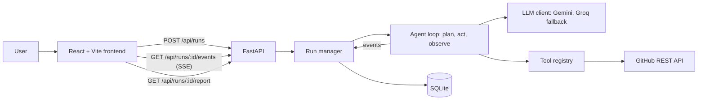

# RepoPilot

**An autonomous AI agent that onboards you to any GitHub repository.**

Paste a public repo URL. RepoPilot plans how to explore it, reads the code on its own, and hands you a ready-to-use onboarding report: what the project does, how it is built, how to run it, and which open issues you should tackle first.

> Built for **Hacktoberfest Hack Day Prayagraj** · CC Club MNNIT Allahabad · Track 1: Applied AI & Next-Gen Agents

<!-- TODO: add a screenshot or GIF of a finished run -->

<!--  -->

**Demo video:** 

---

## The problem

Joining an unfamiliar open-source project is hard. A newcomer faces thousands of files with no map, a README that may be out of date, rarely any architecture docs, and "good first issue" labels that are inconsistent or stale. Every Hacktoberfest, many first-time contributors lose hours before making a single contribution, and some give up.

Existing "chat with your repo" tools are reactive: you need to already know what to ask. RepoPilot is proactive. You give it a URL and it does the exploring.

## What it does

Given a public GitHub repository, the agent:

1. **Plans** how it will explore the repo.
2. **Acts** by choosing which directories to list, which files to read, what to search for and which issues to inspect, using tool calls to the GitHub API.
3. **Observes** each result and **adapts its plan** when it learns something new.
4. **Writes the report** section by section while you watch.

### The report

| Section                | Contents                                                                                |
| ---------------------- | --------------------------------------------------------------------------------------- |
| **Overview**     | What the project is and who it is for                                                   |
| **Architecture** | How the code is organised and how the parts fit together                                |
| **Diagram**      | A Mermaid architecture diagram (falls back to raw source if rendering fails)            |
| **Setup**        | How to run the project locally                                                          |
| **First issues** | Real open issues, ranked, each with a reason it suits a newcomer and a difficulty level |

### Live agent view

The UI streams the agent's work as it happens: the current plan, every tool call, and a summary of each observation. There is no spinner and no black box.

---

## How it works



**Flow:** `POST /api/runs` validates the URL, checks the repo exists, creates a run and starts the agent in a background task. The frontend opens a Server-Sent Events stream. The agent pushes events into a per-run queue, which the stream relays. When the agent finishes, the report is saved to SQLite, a `done` event is sent, and the frontend fetches the final report.

### The agent's tools

The model decides which tool to call and when. There are five:

| Tool              | Purpose                                        |
| ----------------- | ---------------------------------------------- |
| `get_repo_tree` | List files and folders in one directory        |
| `read_file`     | Read a file's text (long files are truncated)  |
| `search_code`   | Find files by path or content keyword          |
| `list_issues`   | List open issues, optionally filtered by label |
| `write_section` | Publish one finished section of the report     |

Noise such as `node_modules`, lockfiles, images and build output is filtered out before the model sees it.

### Reliability

- **LLM fallback:** Gemini is the primary model. If it fails (rate limit, overload, outage), the agent switches to Groq automatically.
- **Retries:** transient provider errors (429 and 5xx) are retried before falling back.
- **Bounded runs:** a run is capped at a maximum number of tool calls and a total time limit, so it always terminates.
- **Tool errors are data:** a failing tool returns `ok: false` to the model so it can adapt, instead of crashing the run.
- **Clear errors:** invalid URLs, missing repos, rate limits and provider failures produce readable messages in the UI.

### Event stream contract

| Event           | Payload                            | Meaning                                                        |
| --------------- | ---------------------------------- | -------------------------------------------------------------- |
| `plan`        | `{ "steps": [...] }`             | Current plan. Sent again when the agent replans.               |
| `tool_call`   | `{ "id", "tool", "args" }`       | The agent is calling a tool                                    |
| `observation` | `{ "id", "ok", "summary" }`      | Result of the matching tool call                               |
| `section`     | `{ "key", "title", "markdown" }` | A finished report section. The same `key` again replaces it. |
| `done`        | `{}`                             | Run complete, fetch the report                                 |
| `error`       | `{ "message" }`                  | Fatal error, stream ends                                       |

---

## Tech stack

| Layer       | Choice                                                        |
| ----------- | ------------------------------------------------------------- |
| Frontend    | React 18, Vite, Tailwind CSS, `react-markdown`, `mermaid` |
| Backend     | Python 3.11+, FastAPI, Uvicorn, `httpx`, Pydantic           |
| AI          | Google Gemini (function calling), Groq as fallback            |
| Data source | GitHub REST API                                               |
| Storage     | SQLite                                                        |
| Testing     | pytest (backend), Vitest (frontend)                           |

Everything runs on free tiers.

---

## Getting started

### Prerequisites

- Python 3.11 or newer
- Node.js 18 or newer
- A free [Google AI Studio](https://aistudio.google.com/) API key (Gemini)
- A free [Groq](https://console.groq.com/) API key (fallback, recommended)
- A GitHub personal access token with **no scopes** (only raises the API rate limit from 60 to 5,000 requests an hour)

### 1. Clone

```bash
git clone <your-repo-url>
cd <repo-folder>
```

### 2. Backend

```bash
cd backend
python -m venv .venv

# macOS / Linux
source .venv/bin/activate
# Windows (cmd)
.venv\Scripts\activate

pip install -r requirements.txt
cp .env.example .env        # Windows: copy .env.example .env
```

Edit `backend/.env` (see [Configuration](#configuration)), then start the server:

```bash
uvicorn app.main:app --reload --port 8000
```

Check it at [http://localhost:8000/api/health](http://localhost:8000/api/health).

### 3. Frontend

In a second terminal:

```bash
cd frontend
npm install
npm run dev
```

Open [http://localhost:5173](http://localhost:5173), paste a repo URL, or click one of the demo repos.

> The frontend reads the API address from `VITE_API_BASE_URL` (default `http://localhost:8000`).

### 4. Verify your AI setup (optional)

```bash
cd backend
python -m scripts.diag_llm     # lists models your keys can access
python -m scripts.smoke_llm    # runs one full tool-calling round trip
```

---

## Configuration

Set these in `backend/.env`. Model IDs are configuration, not code, because providers retire and rename models.

| Variable                  | Description                                                           | Default                      |
| ------------------------- | --------------------------------------------------------------------- | ---------------------------- |
| `GEMINI_API_KEY`        | Gemini API key                                                        | (required for Gemini)        |
| `GEMINI_MODEL`          | Gemini model ID, e.g. a current Flash model                           | (required for Gemini)        |
| `GROQ_API_KEY`          | Groq API key                                                          | (optional fallback)          |
| `GROQ_MODEL`            | A Groq model that supports tool calling, e.g. `openai/gpt-oss-120b` | (optional fallback)          |
| `GITHUB_TOKEN`          | GitHub token, no scopes needed                                        | (recommended)                |
| `FRONTEND_ORIGIN`       | Allowed CORS origin                                                   | `http://localhost:5173`    |
| `DATABASE_URL`          | SQLite path                                                           | `sqlite:///./repopilot.db` |
| `USE_FAKE_RUN`          | Use the scripted fake agent (no API keys needed)                      | `false`                    |
| `AGENT_MAX_TOOL_CALLS`  | Maximum tool calls per run                                            | `14`                       |
| `AGENT_TIMEOUT_SECONDS` | Maximum run time                                                      | `180`                      |
| `LLM_TIMEOUT_SECONDS`   | Timeout per model request                                             | `60`                       |

At least one of Gemini or Groq must be configured.

**Tip:** set `USE_FAKE_RUN=true` to try the whole UI without any API keys. The backend streams a scripted run.

---

## API

| Method   | Endpoint                      | Description                                                                                             |
| -------- | ----------------------------- | ------------------------------------------------------------------------------------------------------- |
| `GET`  | `/api/health`               | Health check                                                                                            |
| `POST` | `/api/runs`                 | Start a run. Body: `{ "repo_url": "https://github.com/owner/name" }`. Returns `{ "run_id": "..." }` |
| `GET`  | `/api/runs/{run_id}/events` | Server-Sent Events stream of the run                                                                    |
| `GET`  | `/api/runs/{run_id}/report` | The final report (`409` until the run is done)                                                        |

Errors use one shape: `{ "error": { "code": "...", "message": "..." } }`.

```bash
curl -X POST http://localhost:8000/api/runs \
  -H "Content-Type: application/json" \
  -d '{"repo_url": "https://github.com/owner/name"}'

curl -N http://localhost:8000/api/runs/<run_id>/events
```

---

## Testing

```bash
# Backend
cd backend
pytest -q

# Frontend
cd frontend
npm test
```

Backend tests cover the health endpoint, URL validation, run creation, each tool with mocked GitHub responses, and the LLM layer. Tests use stub and fake LLM clients, so they run without API keys.

---

## Project structure

```
.
├── backend/
│   ├── app/
│   │   ├── agent/
│   │   │   ├── llm/          # LLM interface, Gemini client, Groq client, fallback
│   │   │   ├── tools/        # GitHub client and the five agent tools
│   │   │   └── fake_run.py   # Scripted run for development
│   │   ├── routes/           # /api/health and /api/runs
│   │   ├── services/         # Run manager, SSE event bus, URL parsing
│   │   ├── db/               # SQLite storage
│   │   ├── config.py         # Settings from environment
│   │   └── main.py           # FastAPI app
│   ├── scripts/              # diag_llm.py, smoke_llm.py, smoke_tools.py
│   └── tests/
├── frontend/                 # React + Vite app
├── docs/                     # Project documentation
└── README.md
```

---

## Troubleshooting

| Symptom                              | Likely cause and fix                                                                                                                |
| ------------------------------------ | ----------------------------------------------------------------------------------------------------------------------------------- |
| `Groq request failed (HTTP 404)`   | `GROQ_MODEL` is not available to your key. Run `python -m scripts.diag_llm` and pick a listed model that supports tool calling. |
| `Gemini request failed (HTTP 503)` | Temporary Google overload. The app retries and then falls back to Groq.                                                             |
| `Gemini model not found`           | Fix `GEMINI_MODEL` in `backend/.env` using the list from `diag_llm`.                                                          |
| Run is slow                          | Some Gemini models spend a long time "thinking". Try a lighter Flash model.                                                         |
| GitHub rate limit error              | Add a `GITHUB_TOKEN` to `backend/.env`.                                                                                         |
| UI cannot reach the backend          | Check the backend is running and `VITE_API_BASE_URL` and `FRONTEND_ORIGIN` match your ports.                                    |
| Edits to `.env` have no effect     | Restart uvicorn. A real environment variable of the same name overrides `.env`.                                                   |

---

## Limitations

- Works on **public** repositories only.
- Large repositories are explored through a bounded number of tool calls, so the report reflects what the agent chose to read, not every file.
- AI-generated content can contain mistakes. Treat the report as a starting map and verify important details in the code.
- Run history is stored locally in SQLite and there is no authentication.

## Roadmap

- "Explain this file" follow-up questions
- Run history view
- Hosted public demo
- Support for private repositories via user-provided tokens

---

## Team

| Name | Role               |
| ---- | ------------------ |
|      | Frontend           |
|      | Backend & AI agent |

## License

Released under the [MIT License](LICENSE).
